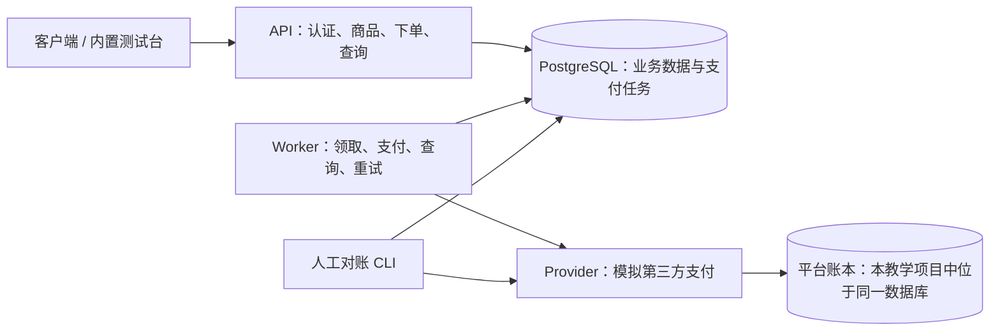

# Shopping：可靠异步支付教学工程

这个项目演示如何把“下单”和“支付”拆成可恢复的流程：事务保证库存、订单、支付记录和任务一起提交；独立 Worker 异步调用模拟支付平台，使用稳定幂等键、租约和版本校验处理并发、超时、崩溃以及结果未知。死信任务提供人工对账入口和审计记录。

这是教学系统。Provider 使用本地 PostgreSQL 表模拟第三方账本；商品写入暂不区分管理员，尚未实现退款、真实渠道鉴权、限流和生产级访问控制。

## 架构与业务流程



1. 客户端登录取得 JWT，提交订单幂等键和商品数量。
2. API 在一个事务中检查幂等、按 ID 顺序锁商品、预留库存，并写订单、明细价格快照、支付记录和支付任务。失败全部回滚。
3. Worker 使用 `FOR UPDATE SKIP LOCKED` 领取任务，设置租约并递增 `version`，提交后再发网络请求。外部支付不占用业务事务的行锁。
4. 平台明确成功：同事务写支付 `succeeded`、订单 `paid`、任务 `completed`。明确业务失败：支付 `failed`、订单 `cancelled`、归还库存，任务仍为 `completed`。
5. 超时/断线时不能判断有没有扣款：支付保持 `unknown` 或 `processing`，重试先查询原交易；只有明确 404 才使用原键、原金额补发。零元订单直接本地完成。
6. 旧 Worker 写回必须匹配领取时的版本；租约过期可由其他 Worker 回收。无法确认且重试耗尽的任务进入 `failed` 死信，保留支付现场等待人工核查。

**下单的 201 不代表支付成功；任务 failed 不代表钱没扣。** 客户端查询 `GET /orders/{id}` 获取最终业务状态。

## 本地安装和运行

需要 Node.js **22.22.0 或更新版本**、npm、Docker Desktop（Linux 容器）。项目通过 Volta 固定 Node 22.22.0、npm 10.9.4。

在项目根目录执行（PowerShell）：

```powershell
npm ci
Copy-Item .env.example .env  # 仅首次执行；保留已有配置
docker compose up -d --wait
npm run migrate
npm run seed
```

随后分别打开三个终端，在项目根目录运行：

```powershell
npm run provider
```

```powershell
npm run worker
```

```powershell
npm start
```

打开 [测试台](http://localhost:3000/)，注册、选择商品并下单。也可以按照 [API 文档](docs/api.md) 直接调用接口。检查 [存活](http://localhost:3000/health) 和 [数据库就绪](http://localhost:3000/health/db)，都应返回 `{"status":"ok"}`。Worker 需要单独启动，否则订单会保持待支付。

`npm run dev`、`worker:dev`、`provider:dev` 分别启用 watch。Ctrl+C 停止对应进程；进程收到 SIGINT/SIGTERM 时停止接收新工作，等待进行中的请求/任务并关闭连接池，最多等待 15 秒。Windows 的强制结束进程不会触发信号清理，任务依靠租约恢复。

## 配置与环境隔离

配置模板：[.env.example](.env.example)，统一校验：[src/config.js](src/config.js)。启动命令只读取 `.env`，操作系统环境变量优先；改动后重启进程。测试只读取 `.env.test`，不会加载 `.env`。生产通过部署环境/密钥管理器注入配置，不提交密钥文件，也不复制进镜像。

| 配置 | 默认值 / 规则 | 使用者 |
| --- | --- | --- |
| `DATABASE_URL` | 可选 PostgreSQL URL；设置后优先于全部 `PG*`，不要写空赋值 | 所有数据库进程和脚本 |
| `PGHOST/PGPORT/PGUSER/PGPASSWORD/PGDATABASE` | 未设置 URL 时，除端口默认 5432 外都必填 | 同上 |
| `DB_POOL_MAX` | 10；每个进程独立上限 | API / Worker / Provider |
| `DB_CONNECTION_TIMEOUT_MS` | 3000；正整数 | 数据库连接和连接池等待 |
| `DB_QUERY_TIMEOUT_MS` | 5000；客户端及服务端 SQL 超时 | 数据库查询 |
| `PORT` | 3000，1–65535 | API |
| `JWT_SECRET` | API 必填；生产至少 32 字符且不能使用开发示例值 | API |
| `JWT_EXPIRES_IN` | `2h`，带单位的正时长 | API |
| `PAYMENT_PROVIDER_URL` | Worker / 对账必填 HTTP(S) 地址 | 支付客户端 |
| `PAYMENT_PROVIDER_TIMEOUT_MS` | 3000，正整数 | Worker / 人工对账 |
| `PAYMENT_PROVIDER_PORT` | 4100 | 模拟 Provider |
| `PAYMENT_MOCK_MODE` | success / fail / timeout / drop | 模拟 Provider |
| `PAYMENT_MOCK_LATENCY_MS` | 100，可为 0 | 模拟 Provider |
| `WORKER_POLL_INTERVAL_MS` | 2000；上一任务结束后等待该时长再领取 | Worker |
| `WORKER_LEASE_SECONDS` | 30；应覆盖网络查询、补发及写回耗时 | Worker |
| `WORKER_MAX_ATTEMPTS` | 5 | Worker |
| `WORKER_CRASH_AFTER_PAY_SUCCESS` | 0；1 用于故障演练，生产禁止 | Worker |
| `WORKER_METRICS_PORT` | 代码默认 0 关闭；模板为 9101，多 Worker 使用不同端口 | Worker |
| `METRICS_TOKEN` | 开发可空；生产至少 32 字符，使用独立随机凭据 | 指标接口 |
| `RECONCILIATION_OPERATOR` | 可空，回退到系统用户名 | 人工对账 |
| `NODE_ENV` | development / test / production | 配置校验 |

缺少必填项、空值、非法端口、负超时或生产弱密钥会在监听端口前抛出配置错误，进程以非零状态结束。报错只给配置名，不回显配置值。迁移/seed 只要求数据库配置，Provider 不要求 API 的 JWT 密钥。数据库可用性由 `/health/db` 检查，API 进程不会因为启动时数据库短暂断开而永久退出。

## 容器部署

第一次准备好 `.env` 后，可一次部署数据库、迁移、API、模拟 Provider 和 Worker：

```powershell
docker compose -f docker-compose.yml -f docker-compose.app.yml up --build -d --wait
docker compose -f docker-compose.yml -f docker-compose.app.yml exec api node scripts/seed.js
docker compose -f docker-compose.yml -f docker-compose.app.yml logs -f api worker provider
```

这是**本地完整部署模板**：容器内数据库地址固定为 `postgres:5432`，支付平台为 `provider:4100`；API 映射宿主机 `.env` 的 `PORT`，Provider/Worker 指标只在 Compose 网络中监听。数据库健康后运行迁移，迁移成功才启动应用。不要同时运行占用相同端口的宿主机进程。

生产交接：构建同一镜像，分别用 `node src/index.js`、`node src/worker.js` 运行 API 和 Worker；先独立执行 `node scripts/migrate.js` 并确认成功。设置 `NODE_ENV=production`、真实数据库和渠道地址、独立强密钥，经 TLS 反向代理暴露 API，Provider 替换为符合本文协议且支持幂等查询的真实适配器。数据库需要备份与恢复演练；扩容时汇总全部进程的连接池预算。当前本地 Compose 预设密码和模拟 Provider 不适用于真实收款。

## 测试与 CI

推荐在独立临时数据库上运行完整测试，包括断库演练：

```powershell
Copy-Item .env.test.example .env.test  # 仅首次执行
docker compose -f docker-compose.test.yml up -d --wait
npm run docs:check
npm test
```

测试数据库固定为 `shopping_test`，模板使用宿主机 **55432**，与开发库的数据卷和容器隔离。每个用例会清空测试业务表；不要让多个测试任务共享该库。未提供 `.env.test` 时，使用 localhost:5432 上的 `shopping_test`，默认跳过两项停库测试。`TEST_DATABASE_URL` 必须显式指向 `shopping_test`。测试要求该数据库用户有建库及迁移权限。

[测试说明和场景](tests/README.md)覆盖事务回滚、并发库存、双层幂等、支付超时、崩溃恢复、多 Worker、死信和人工对账。新增工程交付测试验证配置失败、错误码、requestId、指标鉴权、日志和指标关联。

[GitHub Actions](.github/workflows/ci.yml) 在 push / pull_request 时执行 `npm ci` → OpenAPI 校验 → 迁移 → 全套测试 → Prometheus 配置和规则校验。每次作业使用独立 PostgreSQL 17 服务容器，断库测试只操作该作业容器。

**阻止失败代码合并需要仓库设置配合**：在目标分支 Rulesets / Branch protection 中开启 required status checks，选择 `test`。提交 workflow 文件本身不会自动开启分支保护；第一次推送产生检查后再选择。仅修改本地文件不会触发 GitHub CI。

## 日志、监控和问题排查

服务输出一行一个 JSON，含时间、级别、事件、进程号。请求日志包含 requestId、方法、路由模板、状态码和耗时；下单日志关联订单 ID，Worker 日志关联任务和支付 ID，明确记录重试、unknown、死信与执行结果。不输出请求体、Authorization、SQL 参数或数据库连接串。

API/Provider 的 `/metrics` 和 Worker 指标端口提供 Prometheus 指标：连接池 active/idle/waiting/max、HTTP/SQL 耗时分布、任务 pending/processing/failed、到期待执行任务最长等待、过期租约、Worker 执行与轮询结果。API 负责全库队列指标，避免多个 Worker 重复采集；多 API 汇总时使用 `max` 而非 `sum` 统计同一数据库的队列。

启动本地监控：`docker compose -f docker-compose.monitoring.yml up -d`。默认抓取宿主机 3000 / 4100 / 9101，打开 [Prometheus](http://localhost:9090/) 查看 Targets 与 Alerts。完整容器部署需要把抓取目标改为 Compose 服务名 `api:3000` / `provider:4100` / `worker:9101` 并让 Prometheus 加入同一网络。

具体指标、告警阈值、凭据和排障步骤见 [运维手册](docs/operations.md)。告警规则能在 Prometheus 中判断触发；通知到人还需要接入 Alertmanager 和接收渠道。

## 目录

```text
src/
  index.js / worker.js / provider.js  三个独立入口
  config.js                          分角色配置校验
  routes/ / middleware/              HTTP、鉴权
  services/                          业务逻辑与事务边界
  repositories/                      参数化 SQL
  db/ / observability/ / utils/       连接池、日志指标、金额校验
migrations/                          顺序 SQL 迁移与 schema_migrations 账本
scripts/                             迁移、种子、死信查询与人工对账
tests/                               串行集成测试与故障演练
public/                              开发测试台
docs/                                OpenAPI、调用说明、运维手册
monitoring/                          Prometheus 抓取与告警规则
.github/workflows/ci.yml              自动化验收
Dockerfile / docker-compose*.yml      应用、数据库、测试与监控部署
```

实现依据：[GitHub PostgreSQL 服务容器](https://docs.github.com/en/actions/tutorials/use-containerized-services/create-postgresql-service-containers)、[node-postgres 连接池](https://node-postgres.com/apis/pool)、[Prometheus 告警规则](https://prometheus.io/docs/prometheus/latest/configuration/alerting_rules/)。
